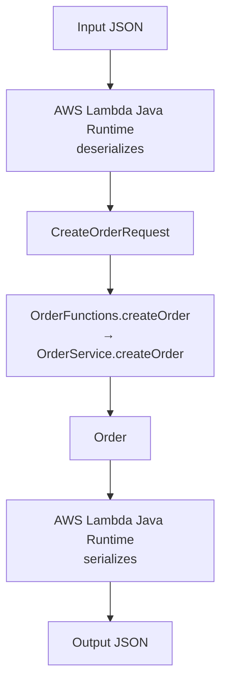
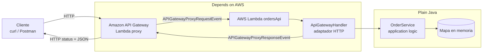

# Orders API — Serverless REST API with AWS Lambda and API Gateway

Laura Valentina Gutiérrez Rico — AREP

REST API in Java 17 + Maven, deployed on AWS Lambda and exposed through Amazon API Gateway, implemented with two architectures: (A) non-proxy integration with mapping templates and (B) Lambda proxy integration with an HTTP adapter.

## Structure

```
orders-api/
├── pom.xml
├── README.md
├── events/proxy-event-get-order.json        # actual event sent by API Gateway in proxy mode
└── src/
    ├── main/java/edu/eci/arem/orders/
    │   ├── domain/                           # Plain Java (no AWS or HTTP)
    │   │   ├── Order.java
    │   │   ├── CreateOrderRequest.java
    │   │   ├── OrderService.java
    │   │   ├── OrderNotFoundException.java
    │   │   └── InvalidOrderException.java
    │   └── lambda/         
    │       ├── OrderFunctions.java         
    │       ├── IdRequest.java
    │       ├── CustomerRequest.java
    │       └── ApiGatewayHandler.java       
    └── test/java/edu/eci/arem/orders/
        ├── OrderServiceTest.java
        └── ApiGatewayHandlerTest.java
```

## Build and test

```bash
mvn test       # unit tests (no AWS required)
mvn package    # generates target/orders-api-1.0.jar (includes dependencies)
```

---

## 1. API Contract Design

| Operation | Method and URL | Parameters | Body | Success | Errors |
|---|---|---|---|---|---|
| Create order | `POST /orders` | — | `{"customerId","product","quantity"}` | `201 Created` + order + `Location: /orders/{id}` header | `400` (missing fields, quantity ≤ 0, invalid JSON) |
| Get order | `GET /orders/{id}` | path: `id` | — | `200 OK` + order | `404` if it does not exist |
| Search by customer | `GET /orders?customerId={customerId}` | query: `customerId` | — | `200 OK` + list (may be `[]`) | `400` if `customerId` is missing |
| Delete order | `DELETE /orders/{id}` | path: `id` | — | `204 No Content` | `404` if it does not exist |
| Unexpected error | any | — | — | — | `500 Internal Server Error` |

Error format (always the same):

```json
{ "error": "ORDER_NOT_FOUND", "message": "Order ORD-999 does not exist" }
```

Codes used: `BAD_REQUEST`, `ORDER_NOT_FOUND`, `INTERNAL_ERROR`.

### Questions

1. **What are the resources?** The `/orders` collection and each individual order at `/orders/{id}`.
2. **Why `/orders/{id}`?** Because the id uniquely identifies a specific resource; in REST, the resource identity belongs in the path.
3. **Why is `customerId` a query parameter?** Because it does not identify a resource; it filters the `/orders` collection. It is optional and can be combined with future filters.
4. **What does `POST /orders` return?** `201 Created`, the body containing the created order (including the generated id), and the `Location: /orders/{id}` header.
5. **What does it return if the order does not exist?** `404 Not Found` with the `ORDER_NOT_FOUND` error JSON.
6. **What does an error contain?** A stable machine-readable code (`error`) and a human-readable message (`message`).

---

## 2. Part I — Plain Java Application

`OrderService` contains `createOrder`, `getOrder`, `getOrdersByCustomer`, and `deleteOrder`. It uses an in-memory `ConcurrentHashMap` with two preloaded orders (`ORD-001`/`CUST-42` and `ORD-42`/`CUST-7`). **It is not persistent storage**: each Lambda execution environment has its own copy, which is lost when the environment is recycled.

Domain errors: `InvalidOrderException` (invalid input) and `OrderNotFoundException`.

### Checkpoint 1

1. **Can it be tested without AWS?** Yes, `OrderServiceTest` tests all the logic with JUnit.
2. **Does it require a web server?** No.
3. **Does it require Spring Boot?** No.
4. **What does the JAR contain?** The project's compiled classes and dependencies (aws-lambda-java-core, aws-lambda-java-events, Gson), packaged with `maven-shade-plugin`.
5. **Which parts know about HTTP?** None of the `domain` package. Only `ApiGatewayHandler` (in the `lambda` package) knows about HTTP.

---

## 3. Part II — Deployment on AWS Lambda

1. `mvn package`.
2. AWS Console → Lambda → *Create function* → Runtime **Java 17**, name `createOrder`.
3. *Upload from* → `.jar` → `target/orders-api-1.0.jar`.
4. *Runtime settings* → Handler: `edu.eci.arem.orders.lambda.OrderFunctions::createOrder`.
5. *Test* with the event:

```json
{ "customerId": "CUST-42", "product": "MacBook Air", "quantity": 1 }
```

Response:

```json
{ "id": "ORD-101", "customerId": "CUST-42", "product": "MacBook Air", "quantity": 1 }
```

Second test value: `{ "customerId": "CUST-7", "product": "Mouse", "quantity": 3 }`. With `{ "customerId": "CUST-7", "quantity": 0 }`, Lambda responds with `{"errorMessage":"BAD_REQUEST: product is required", ...}`.

Repeat for `getOrder` (handler `...OrderFunctions::getOrder`, event `{"id":"ORD-42"}`) and `getOrdersByCustomer` (handler `...OrderFunctions::getOrdersByCustomer`, event `{"customerId":"CUST-42"}`).

### How does Lambda convert JSON ↔ Java?

When the handler is a `Class::method` method whose parameter is a POJO, the Lambda Java runtime deserializes the input JSON into that type using its internal serializer (based on Jackson): it instantiates the class with the no-argument constructor and assigns each JSON property through its setter/field with the same name. Unknown properties are ignored and missing ones remain `null`. The return value is serialized in the same way (getters → JSON properties). If the method throws an exception, Lambda returns `{"errorMessage", "errorType", "stackTrace"}`.

Verified: sending `{"customerId":"CUST-42","product":"X","quantity":1,"extra":true}` works (`extra` is ignored); omitting `quantity` produces `null` and validation responds with `BAD_REQUEST`.

### Checkpoint 2 — diagram



---

## 4. Parts III and IV — API Gateway with mapping templates (Architecture A)

API Gateway → *Create API* → **REST API** → name `orders-api-mapping`.

Resources: `/orders` and `/orders/{id}`. For each method: *Integration type* = **Lambda Function**, **do not** check *Lambda proxy integration*.

### `GET /orders/{id}` → Lambda `getOrder`

*Integration request* → *Mapping templates* → `application/json`:

```
{ "id": "$input.params('id')" }
```

### `GET /orders` → Lambda `getOrdersByCustomer`

*Method request* → *URL query string parameters* → `customerId`.
*Integration request* → mapping template `application/json`:

```
{ "customerId": "$input.params('customerId')" }
```

### `POST /orders` → Lambda `createOrder`

*Integration request* → mapping template `application/json`:

```
$input.json('$')
```

(For POST, add `201` under *Method response* and leave `201` as the default under *Integration response*.)

### Mapping errors to HTTP status codes

`OrderFunctions` throws exceptions with a prefix. For each method:

1. *Method response* → add `400` and `404` (and `201` for POST).
2. *Integration response* → *Create response*:

| Lambda error regex | Status | Mapping template (`application/json`) |
|---|---|---|
| `BAD_REQUEST:.*` | 400 | see below |
| `ORDER_NOT_FOUND:.*` | 404 | see below |

```
#set($msg = $input.path('$.errorMessage'))
{ "error": "$msg.substring(0, $msg.indexOf(':'))", "message": "$msg.substring($msg.indexOf(':') + 2)" }
```

*Deploy API* → stage `prod`.

### Tests

```bash
URL=https://<api-id>.execute-api.<region>.amazonaws.com/prod

curl -i $URL/orders/ORD-42                    # 200
curl -i $URL/orders/ORD-999                   # 404
curl -i "$URL/orders?customerId=CUST-42"      # 200
curl -i "$URL/orders?customerId=CUST-100"     # 200 []
curl -i -X POST $URL/orders -H "Content-Type: application/json" \
     -d '{"customerId":"CUST-42","product":"MacBook Air","quantity":1}'   # 201
curl -i -X POST $URL/orders -H "Content-Type: application/json" \
     -d '{"customerId":"CUST-42","quantity":0}'                          # 400
```

### Checkpoint 3 — API Gateway responsibilities (Architecture A)

API Gateway handles: routing by method/resource, extraction of path and query params, transformation of the request into JSON, selection of the status code using a regex against the error message, and transformation of the error response.

- **Advantages:** the Java code stays clean (it receives and returns domain POJOs and does not know about HTTP); the HTTP contract can be changed without recompiling; validation/transformation happens at the edge.
- **Disadvantages:** HTTP logic is spread across console configuration that is difficult to version and test locally; status codes depend on a fragile "contract" (prefixes in exception messages); each new method requires repeating templates and mappings; debugging VTL is difficult.

---

## 5. Part V — Lambda Proxy Integration (Architecture B)

1. Create Lambda `ordersApi`, Java 17, same JAR, handler `edu.eci.arem.orders.lambda.ApiGatewayHandler::handleRequest`.
2. New REST API `orders-api-proxy`, resources `/orders` and `/orders/{id}`.
3. Methods `POST /orders`, `GET /orders`, `GET /orders/{id}`, `DELETE /orders/{id}` → *Lambda Function* with **Lambda proxy integration enabled** → `ordersApi`.
4. *Deploy API* → `prod`.

### Where each piece of data is in the proxy event (`events/proxy-event-get-order.json`)

| Dato | Campo |
|---|---|
| HTTP method | `httpMethod` |
| Path | `path` (and `resource` = `/orders/{id}` template) |
| Path params | `pathParameters` |
| Query params | `queryStringParameters` |
| Headers | `headers` |
| Body | `body` (string, not an object) |

### HTTP adapter

`ApiGatewayHandler` is the only component that knows about `APIGatewayProxyRequestEvent`, status codes, and headers. It extracts parameters, calls `OrderService`, and translates:

| Domain result | HTTP |
|---|---|
| created order | `201` + `Location` |
| order / list | `200` |
| deleted | `204` |
| `InvalidOrderException` / invalid JSON | `400` |
| `OrderNotFoundException` | `404` |
| any other exception | `500 INTERNAL_ERROR` (without exposing internal details) |

### Tests

```bash
URL=https://<api-id>.execute-api.<region>.amazonaws.com/prod
curl -i -X POST $URL/orders -H "Content-Type: application/json" \
     -d '{"customerId":"CUST-42","product":"MacBook Air","quantity":1}'
# HTTP/2 201   location: /orders/ORD-101
# {"id":"ORD-101","customerId":"CUST-42","product":"MacBook Air","quantity":1}

curl -i $URL/orders/ORD-42
# HTTP/2 200   {"id":"ORD-42","customerId":"CUST-7","product":"Keyboard","quantity":2}

curl -i $URL/orders/ORD-999
# HTTP/2 404   {"error":"ORDER_NOT_FOUND","message":"Order ORD-999 does not exist"}

curl -i "$URL/orders?customerId=CUST-42"
# HTTP/2 200   [{"id":"ORD-001",...},{"id":"ORD-101",...}]

curl -i -X POST $URL/orders -H "Content-Type: application/json" -d '{"customerId":"CUST-42"}'
# HTTP/2 400   {"error":"BAD_REQUEST","message":"product is required"}

curl -i -X DELETE $URL/orders/ORD-42      # HTTP/2 204
curl -i -X DELETE $URL/orders/ORD-999     # HTTP/2 404
```

---

## 6. Architecture Comparison

1. **More configuration in API Gateway?** A: request templates, method responses, integration responses, and regex per method.
2. **More Java infrastructure code?** B: the `ApiGatewayHandler` adapter.
3. **Easier to test locally?** B: the adapter is tested with JUnit by building events (`ApiGatewayHandlerTest`); in A, HTTP mapping can only be tested after deployment.
4. **Where are status codes defined?** A: in API Gateway *integration responses*. B: in `ApiGatewayHandler`.
5. **What happens with 30 operations?** A: 30 sets of templates and mappings duplicated in the console, which is difficult to maintain. B: routing grows in a single versioned file; if it grows too much, it can be split into several handlers.
6. **Cleaner business logic?** In both, `OrderService` does not know about HTTP; A also keeps the Lambda functions free of HTTP code, but requires encoding statuses in exception messages.
7. **Easier for another developer to understand?** B: all HTTP behavior is in code, in one place, with tests.
8. **Which would I choose for a large system?** B, because the HTTP configuration is versioned, testable, and scales better; API Gateway is left to do what it does well (routing, authentication, throttling). Business logic remains isolated in `domain`.

---

## 7. Diagrama de la arquitectura final



---

## 8. Use of the AI Assistant and Critique of Its Decisions

Asistente usado: Claud

**Decision 1 — A single Lambda for the entire API (proxy).**
- *Why it was proposed:* fewer functions to deploy and a single routing point.
- *Do I agree?* Yes for this size.
- *Alternative:* one Lambda per operation (independent permissions and scaling, but no shared in-memory state and more deployments).
- *Implemented:* one Lambda (`ApiGatewayHandler`) in Architecture B; in A, one per operation was kept because each mapping points to a different method.

**Decision 2 — Validation in `OrderService`, not in API Gateway or the handler.**
- *Why:* the rules (quantity > 0, required fields) are business rules.
- *Do I agree?* Yes; this allows them to be tested without AWS and applied equally in both architectures.
- *Alternative:* request validators/JSON Schema models in API Gateway.
- *Implemented:* validation in the domain with `InvalidOrderException`; the handler only translates it to `400`.

**Decision 3 — Errors using domain exceptions translated by the adapter.**
- *Why:* to keep HTTP concepts out of the domain; exceptions express the result in business terms.
- *Do I agree?* Yes. One weakness: in Architecture A, the agent had to encode the error type as a prefix in the message (`BAD_REQUEST:`), which is fragile.
- *Alternative:* have `OrderService` return `Optional`/typed results, or have the domain return objects with an HTTP code (rejected because it introduces HTTP into the domain).
- *Implemented:* domain exceptions (`OrderNotFoundException`, `InvalidOrderException`) and translation to status codes only in `ApiGatewayHandler` (or in the integration responses in A).

---

## 9. Final Challenge — `DELETE /orders/{id}`

### Prediction

1. **Classes that change:** `OrderService` (new `deleteOrder`) and `ApiGatewayHandler` (new DELETE route).
2. **New Lambda?** No, the same proxy Lambda.
3. **Does API Gateway change?** Yes, add the `DELETE` method to `/orders/{id}` (proxy) and redeploy.
4. **Deletion logic:** in `OrderService`.
5. **204 / 404 decision:** in `ApiGatewayHandler`; the domain only throws `OrderNotFoundException`.
6. **Tests:** delete an existing order, delete a nonexistent order (service), and `204` followed by `404` (handler).

### Comparison with the agent

The agent's implementation matches the prediction. The only additional decision was for `deleteOrder` not to return `boolean` but to throw `OrderNotFoundException`, keeping it consistent with `getOrder` and avoiding repeated "does not exist" logic in the handler.

---

## 10. Unexpected Internal Error

Any unexpected exception is caught by `ApiGatewayHandler`, which responds with `500` and `{"error":"INTERNAL_ERROR","message":"Unexpected error"}` without exposing the stack trace. An unsupported method responds with `405`.
